# CofreSmart — Cofre Estoque Inteligente

> Cada retirada do cofre vira previsão de demanda e compra na hora certa.

---

> **3º Lugar na Trilha Einsan Tech — Hackathon Connect 7.0**
> 14º lugar geral entre 76 participantes | Nota media: 8,5/10

Certificado oficial: [docs/certificado-hackathon-connect-7.0.pdf](docs/certificado-hackathon-connect-7.0.pdf)

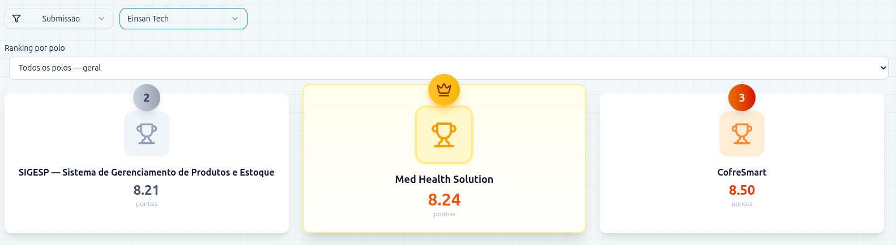

---

> **Aviso de dados de teste:** Todos os dados do prototipo sao simulados, no formato que um cofre real enviaria; nada aqui sao dados reais de farmacia.

## O Desafio

**Hackathon Connect 7.0 — Trilha Einsan Tech**

A Einsan Tech propoe hardware de seguranca para farmacias: cofres refrigerados com retardo de abertura, desenvolvidos para reduzir o impacto de assaltos a produtos de alto valor como canetas emagrecedoras e medicamentos refrigerados de uso controlado.

O desafio apresentado pela banca foi:

- **Pergunta oficial:** Como transformar dados de estoque e consumo em inteligencia para prever a demanda e orientar a reposicao e a compra de medicamentos de alto custo refrigerados?
- **Contexto:** O cofre ja existe e ja registra cada abertura. O problema e que esses dados de movimentacao ficam sem uso; nao ha previsao de demanda, nao ha controle de validade por lote e nao ha aviso de quando e quanto comprar.
- **Restricao central da banca:** A solucao precisa ser economicamente viavel para nao encarecer um produto que ja tem alto valor agregado.

Minha atuacao foi de **Lider Tecnico e Engenheiro de Software**: defini a arquitetura em 6 camadas, escrevi e testei todo o codigo de producao, integrei os modelos estatisticos de previsao e o assistente de IA, e coordenei a divisao de trabalho da equipe.

## A Solucao

Sistema integrado que da baixa automatica no estoque a cada retirada do cofre, preve o consumo de cada medicamento com modelos estatisticos de media movel e suavizacao exponencial, calcula ponto de pedido e quantidade sugerida com nivel de servico de 95%, controla lotes por FEFO (First Expired, First Out), detecta anomalias de demanda via z-score e comunica o fornecedor e o gestor da farmacia quando e quanto comprar — tudo em um painel web com assistente de IA deterministico sobre os dados ja processados pelo pipeline.

A escolha por modelos simples e explicaveis foi uma resposta direta ao ponto de atencao da banca: a solucao funciona sem GPU, sem re-treinamento continuo e sem infraestrutura cara, tornando a integracao ao cofre existente financeiramente viavel.

## Demonstração Online

O painel interativo está publicado e acessível no Streamlit Community Cloud:
- Link da aplicação: [cofre-estoque-inteligente-7uvxcnxc5dhfyr29ifx9vg.streamlit.app](https://cofre-estoque-inteligente-7uvxcnxc5dhfyr29ifx9vg.streamlit.app/)

## Apresentação

O arquivo da apresentação executiva do projeto está disponível no repositório:
- Apresentação em PDF: [docs/apresentacao.pdf](docs/apresentacao.pdf)

<details>
<summary>Ver os slides</summary>

<table>
<tr>
<td align="center"><br><sub>Slide 1: Cofre Estoque Inteligente</sub></td>
<td align="center">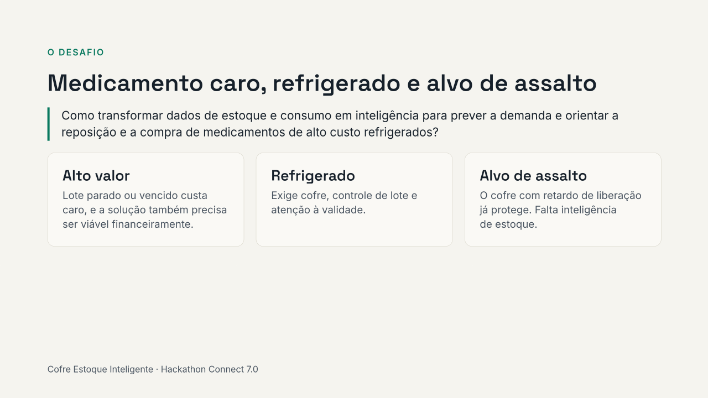<br><sub>Slide 2: Medicamento caro, refrigerado e alvo de assalto</sub></td>
<td align="center">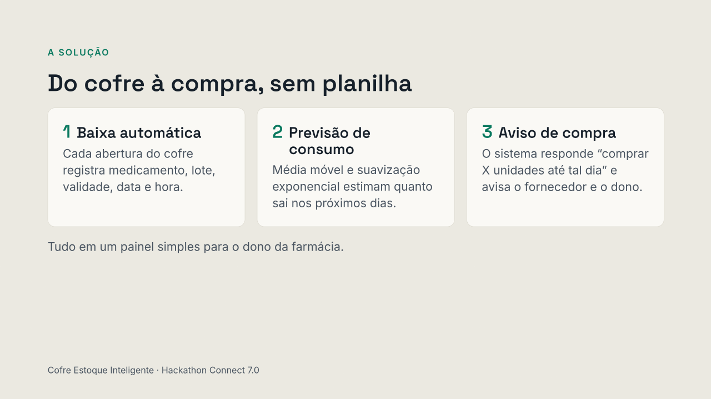<br><sub>Slide 3: Do cofre à compra, sem planilha</sub></td>
</tr>
<tr>
<td align="center">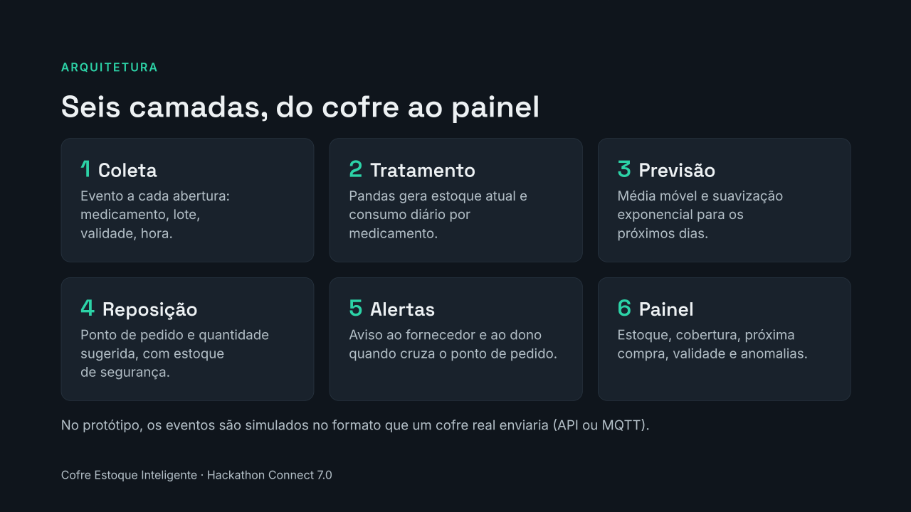<br><sub>Slide 4: Seis camadas, do cofre ao painel</sub></td>
<td align="center">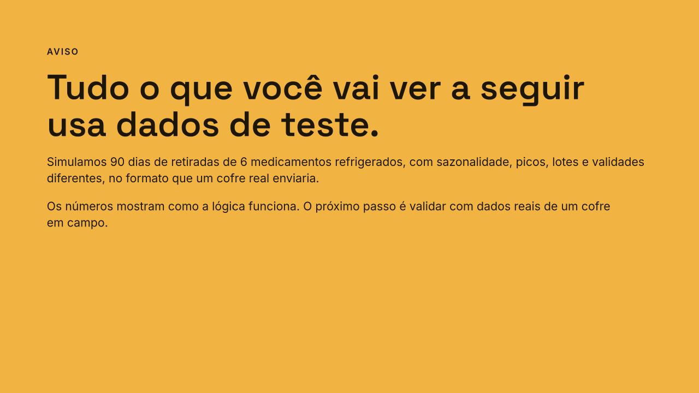<br><sub>Slide 5: Tudo o que você vai ver a seguir usa dados de teste</sub></td>
<td align="center">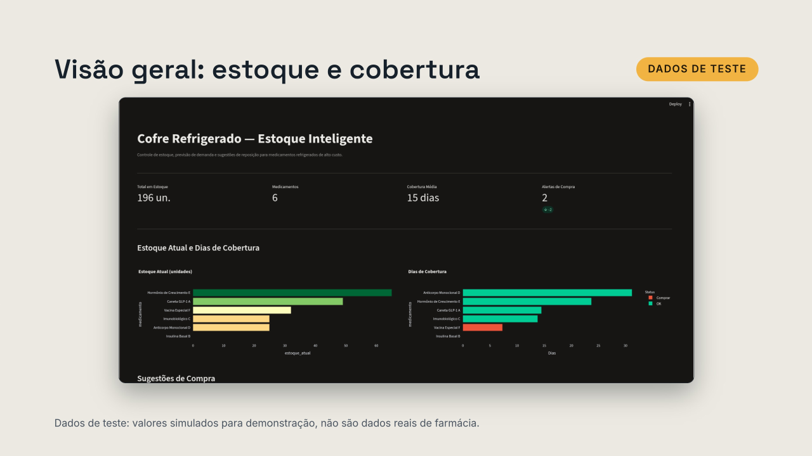<br><sub>Slide 6: Visão geral: estoque e cobertura</sub></td>
</tr>
<tr>
<td align="center">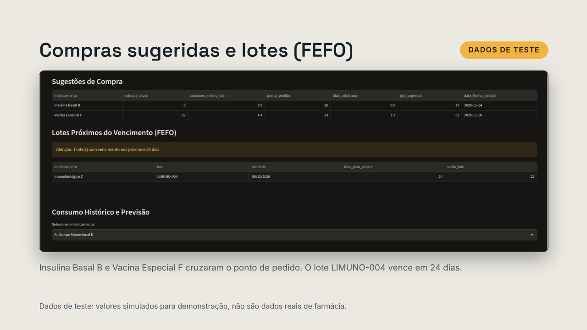<br><sub>Slide 7: Compras sugeridas e lotes (FEFO)</sub></td>
<td align="center">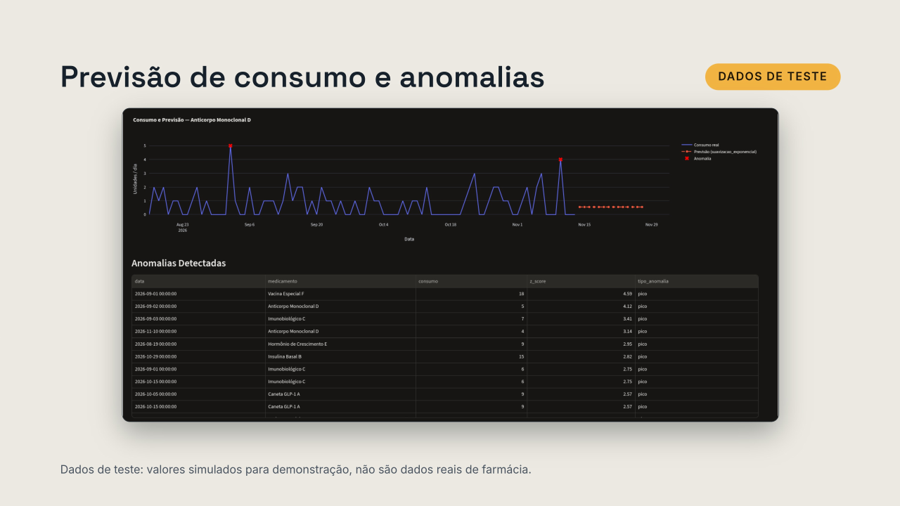<br><sub>Slide 8: Previsão de consumo e anomalias</sub></td>
<td align="center">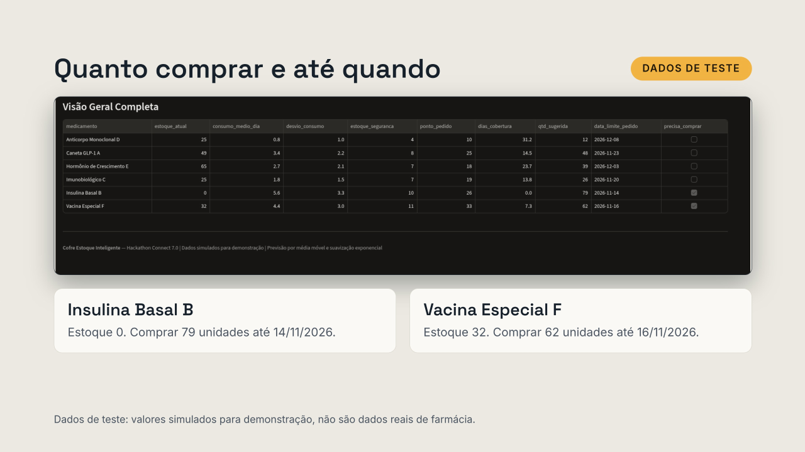<br><sub>Slide 9: Quanto comprar e até quando</sub></td>
</tr>
<tr>
<td align="center">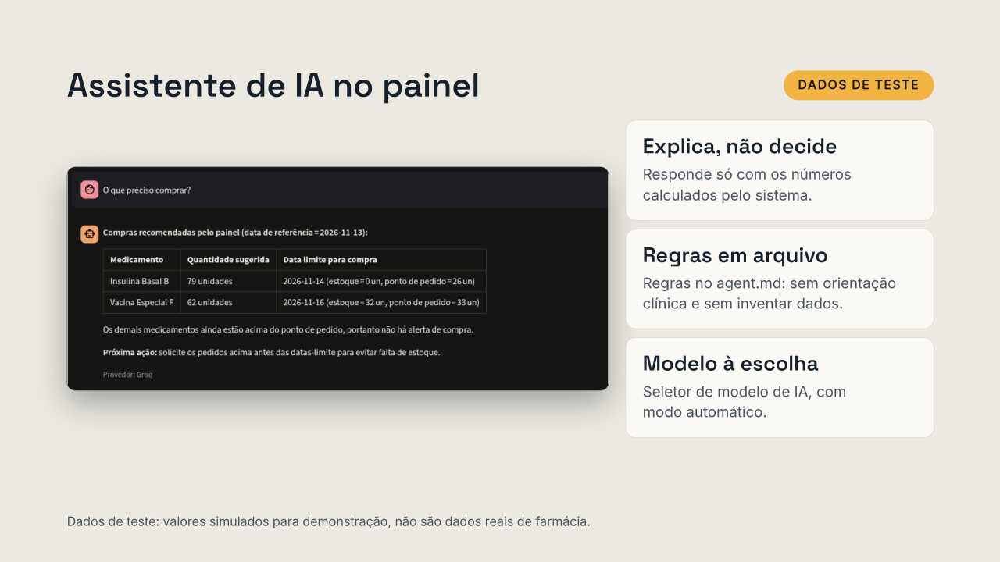<br><sub>Slide 10: Assistente de IA no painel</sub></td>
<td align="center">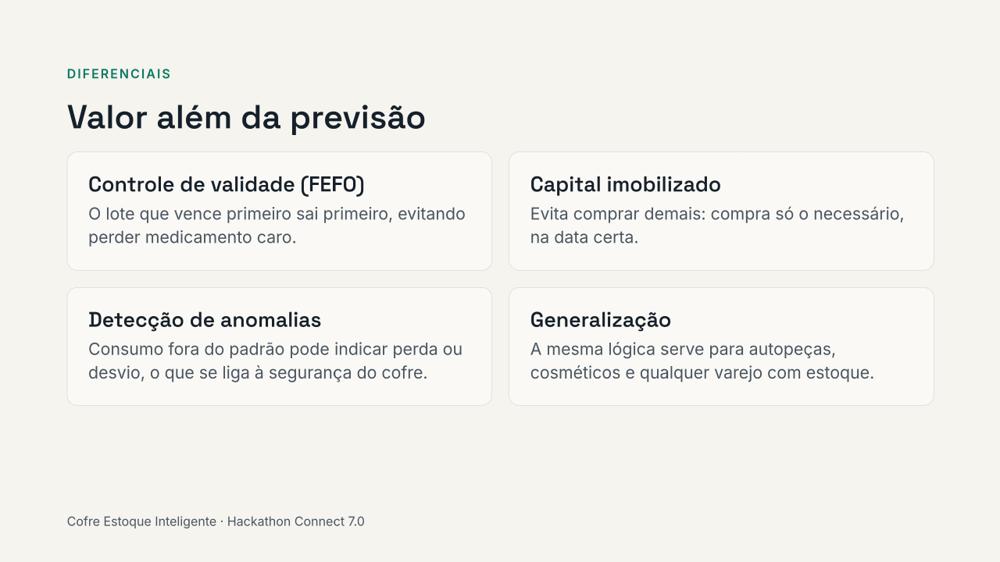<br><sub>Slide 11: Valor além da previsão</sub></td>
<td align="center"><br><sub>Slide 12: Solução leve para um produto de alto valor</sub></td>
</tr>
<tr>
<td align="center">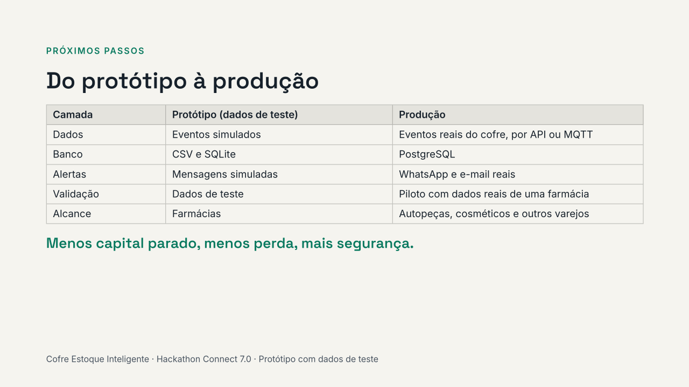<br><sub>Slide 13: Do protótipo à produção</sub></td>
<td></td>
<td></td>
</tr>
</table>

</details>

## Arquitetura

O fluxo completo da informação opera nas seguintes camadas:

```
Cofre Refrigerado -> Coleta de Dados -> Tratamento -> Previsão -> Reposição -> Alertas -> Painel
```

- **Cofre Refrigerado:** Gera registros a cada abertura contendo medicamento, lote, data de validade, quantidade e data/hora.
- **Coleta de Dados:** Recebe os eventos brutos e realiza a persistência estruturada em arquivos CSV e banco relacional SQLite local.
- **Tratamento:** Processa e consolida as movimentações em saldo de estoque atual e série temporal agregada de consumo diário.
- **Previsão:** Aplica modelos estatísticos de média móvel e suavização exponencial, selecionando o modelo com menor erro por medicamento.
- **Reposição:** Calcula estoque de segurança, ponto de pedido, quantidade sugerida e data limite de solicitação para nível de serviço de 95%.
- **Alertas:** Gera comunicados direcionados ao fornecedor e ao gestor da farmácia sobre compras necessárias, lotes críticos e anomalias.
- **Painel:** Disponibiliza interface interativa com indicadores operacionais, gráficos de consumo, previsões e assistente de IA.

Documentação técnica complementar: [docs/arquitetura.md](docs/arquitetura.md).

## Funcionalidades

Recursos implementados e validados no código da aplicação:
- **Previsão por média móvel e suavização exponencial:** Comparação de modelos estatísticos com seleção do menor MAPE via backtesting temporal.
- **Ponto de pedido e quantidade sugerida:** Cálculo automático de reposição baseado em consumo médio, prazo de entrega do fornecedor e estoque de segurança para 95% de nível de serviço.
- **Controle FEFO (First Expired, First Out):** Rastreamento de saldo individualizado por lote e avisos preventivos para itens com vencimento em até 30 dias.
- **Detecção de anomalias:** Identificação estatística de picos ou quedas incomuns de demanda baseada no método de z-score.
- **Alertas operacionais simulados:** Emissão de comunicados padronizados para fornecedores e gestores sobre compras imediatas e controle de validades.
- **Painel visual em Streamlit:** Visualização analítica com KPIs de estoque, gráficos comparativos de cobertura, curvas de projeção e filtros interativos.
- **Assistente de IA integrado:** Agente conversacional que atua sobre o contexto calculado, regido pelas regras de negócio e restrições descritas em [agent.md](agent.md).
- **Seleção e fallback de provedores de LLM:** Alternância manual e automática entre múltiplos provedores compatíveis (Anthropic, OpenAI, Groq, Google Gemini, OpenRouter e endpoints locais).
- **Controle de sessão e fatos pré-calculados:** Limite de 15 perguntas por sessão no painel e pré-cálculo em Python de rankings e maiores picos para garantir respostas exatas sem depender de ordenação pelo modelo.

## Como Rodar

### Pré-requisitos
- Python 3.10 ou superior
- Git

### Preparação do ambiente

No Linux (Ubuntu / Linux Mint) - Bash:
```bash
git clone https://github.com/Rafael-Boaro/cofre-estoque-inteligente.git
cd cofre-estoque-inteligente
python3 -m venv .venv
source .venv/bin/activate
pip install -r requirements.txt
```

No Windows - PowerShell:
```powershell
git clone https://github.com/Rafael-Boaro/cofre-estoque-inteligente.git
cd cofre-estoque-inteligente
python -m venv .venv
.\.venv\Scripts\Activate.ps1
pip install -r requirements.txt
```

### Comandos de execução

Com o ambiente virtual ativo, utilize os comandos do projeto:

1. Executar os testes automatizados:
```bash
pytest
```

2. Gerar dados simulados de eventos do cofre:
```bash
python scripts/gerar_dados.py
```

3. Executar o pipeline de tratamento, previsão e reposição:
```bash
python scripts/rodar_pipeline.py
```

4. Iniciar o painel no navegador:
```bash
streamlit run app/painel.py
```

### Assistente de IA

O assistente no painel funciona opcionalmente. Para utilizá-lo com chaves de provedores de IA:
- No ambiente local: copie [.streamlit/secrets.toml.example](.streamlit/secrets.toml.example) para `.streamlit/secrets.toml` e informe a chave do provedor escolhido (por exemplo, `GROQ_API_KEY`, `GEMINI_API_KEY`, `OPENAI_API_KEY` ou `ANTHROPIC_API_KEY`). Nunca versione esse arquivo.
- No Streamlit Community Cloud: adicione as mesmas variáveis em **Settings > Secrets** da sua aplicação publicada.
- Para validar a conexão e a latência dos provedores configurados:
```bash
python scripts/testar_provedores.py
```

## Estrutura do Projeto

```
cofre-estoque-inteligente/
├── app/                  Painel web interativo em Streamlit
├── data/                 Arquivos brutos simulados e tabelas processadas pelo pipeline
├── docs/                 Documentação da arquitetura e apresentação em PDF e slides
├── scripts/              Scripts de geração de dados, execução do pipeline e testes operacionais
├── src/                  Módulos de coleta, tratamento, previsão, reposição, alertas e assistente
├── tests/                Suíte completa de testes automatizados com pytest
├── .streamlit/           Configuração de temas e exemplo de segredos para execução local e em nuvem
├── agent.md              Instruções de sistema e regras de negócio do assistente conversacional
├── requirements.txt      Relação de dependências do ambiente Python
└── README.md             Documentação central do projeto
```

## Tecnologias

Bibliotecas e dependências verificadas em [requirements.txt](requirements.txt):
- **pandas:** Manipulação e estruturação de séries temporais e tabelas relacionais.
- **numpy:** Operações numéricas e cálculos matemáticos.
- **plotly:** Renderização de gráficos analíticos e interativos.
- **streamlit:** Criação da interface de usuário e publicação da aplicação web.
- **statsmodels:** Modelagem estatística e previsão via suavização exponencial simples.
- **scikit-learn:** Ferramentas de apoio e métricas estatísticas.
- **pytest:** Framework de testes unitários e de integração.
- **anthropic:** SDK nativo para comunicação com modelos Claude.
- **openai:** SDK para comunicação com a API da OpenAI e endpoints compatíveis.

## Viabilidade Financeira

- **Modelos simples e explicáveis:** O uso de média móvel e suavização exponencial elimina a necessidade de infraestrutura cara de servidores dedicados a GPUs ou re-treinamento contínuo.
- **Menos capital parado e menos perda por validade:** A determinação assertiva do ponto de pedido previne estoques inflados, enquanto a priorização FEFO reduz diretamente o descarte de medicamentos refrigerados de alto valor.
- **Caminho para produção:**
  - Migração de SQLite para PostgreSQL gerenciado com esquema relacional normalizado.
  - Substituição da geração simulada por recepção de eventos via API REST (FastAPI) ou protocolo MQTT conectado ao hardware do cofre.
  - Envio de alertas reais via integrações oficiais de WhatsApp Business API ou serviços corporativos de e-mail.
- **Uso econômico de IA:** O modelo de linguagem atua apenas na interpretação de dados já consolidados pelo pipeline. O limite de até 15 perguntas por sessão e o truncamento de mensagens contêm o consumo de tokens e evitam custos imprevistos.

## Equipe

| Integrante | Papel |
|---|---|
| Rafael Boaro — Lider Tecnico e Engenheiro de Software | Arquitetura da solucao em 6 camadas; desenvolvimento, integracao e testes de todo o codigo de producao; coordenacao e divisao de tarefas do time |
| Felipe Oliveira | Revisao e aprimoramento do codigo |
| Renan Azarias | Apresentacao do projeto, explicacao e gravacao dos videos |
| Felipe Garcia | Apresentacao do projeto, explicacao e gravacao dos videos |

[Rafael Boaro](https://github.com/Rafael-Boaro) atuou como Lider Tecnico e Engenheiro de Software: definiu a arquitetura em 6 camadas, implementou e testou todos os modulos de coleta, tratamento, previsao, reposicao, alertas e o assistente de IA deterministico, e coordenou a divisao de trabalho da equipe. Felipe Oliveira revisou e aprimorou o codigo. Renan Azarias e Felipe Garcia conduziram a apresentacao, a explicacao e a gravacao dos videos.
